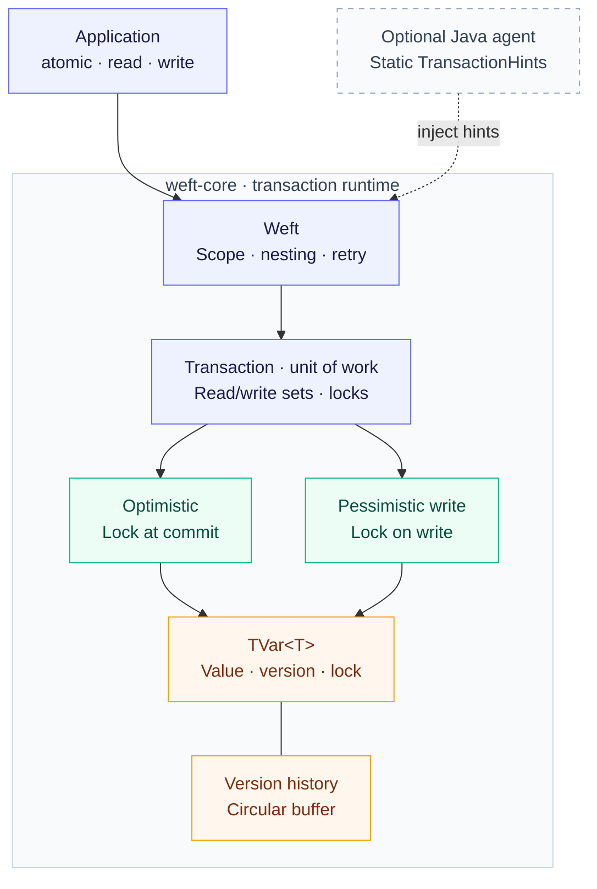

# Weft

**Instrumented Adaptive Software Transactional Memory**

Weft is a transactional memory library for **Java 25**. Transactions buffer changes to
shared `TVar<T>` values and commit them together after validation. Conflicting attempts
are retried automatically.

The core library defaults to optimistic locking. An optional Java agent analyzes read/write
call sites so the runtime can choose between optimistic and pessimistic write locking.

- **Atomic updates** across multiple transactional values, with read-your-writes semantics.
- **Flat nesting** that shares the outer transaction's buffered changes and retry budget.
- **Scoped execution** for independent transactions on platform and virtual threads.
- **Bounded version history** with explicit resizing and snapshot lookup.

## Contents

- [Quick start](#quick-start)
- [Build and test](#build-and-test)
- [Architecture](#architecture)
- [Transaction behavior](#transaction-behavior)
- [Concurrency protocols](#concurrency-protocols)
- [Version history](#version-history)
- [Instrumentation agent](#instrumentation-agent)
- [Errors and retries](#errors-and-retries)
- [Design patterns](#design-patterns)
- [Benchmarks](#benchmarks)

## Quick start

Wrap related reads and writes in `Weft.atomic`. For example, transfer a balance between
two accounts in one transaction:

```java
import tech.provokedynamic.weft.atomic.Weft;
import tech.provokedynamic.weft.atomic.TVar;

TVar<Integer> source = new TVar<>(100);
TVar<Integer> destination = new TVar<>(0);

Weft.atomic(() -> {
    int balance = Weft.read(source);
    if (balance >= 10) {
        Weft.write(source, balance - 10);
        Weft.write(destination, Weft.read(destination) + 10);
    }
});
```

Reads within the transaction see its buffered writes, including `null` values. Other
transactions can observe the new values after a successful commit.

Bodies may execute more than once. Keep I/O and irreversible side effects outside them,
and publish computed results after `atomic` returns. Store immutable values or replace
objects through `Weft.write`; mutating a returned object directly bypasses buffering.

## Build and test

Use **JDK 25** and **Maven 3.9+**. Set `JAVA_HOME` to a JDK 25 installation; no preview
flags are required.

```bash
mvn clean verify
```

This runs the core and agent tests and packages all three modules:

| Module            | Artifact                                          | Purpose                           |
| ----------------- | ------------------------------------------------- | --------------------------------- |
| `weft-core`      | `weft-core/target/weft-core-1.0-SNAPSHOT.jar`   | Transaction API and runtime       |
| `weft-agent`     | `weft-agent/target/weft-agent-1.0-SNAPSHOT.jar` | Optional bytecode instrumentation |
| `weft-benchmark` | `weft-benchmark/target/benchmarks.jar`           | Runnable JMH suite                |

Generate the aggregated API documentation with strict Javadoc checks:

```bash
mvn javadoc:aggregate
```

The core uses the SLF4J API; applications choose their logging backend and configuration.
Logback is a core test dependency. Dependency and plugin versions are centralized in
[`pom.xml`](pom.xml). Generated JMH harness classes are excluded from API documentation.

## Architecture



The core runs independently of the agent. When enabled, the agent rewrites application
classes to pass workload hints to the core; it does not bundle the core runtime.
The benchmark module depends on the core and uses explicit hints for its forced protocols.

| Component                                                                                                          | Responsibility                                                |
| ------------------------------------------------------------------------------------------------------------------ | ------------------------------------------------------------- |
| [`Weft`](weft-core/src/main/java/tech/provokedynamic/weft/atomic/Weft.java)                                    | Public API, transaction scope, nesting, and retries           |
| [`Transaction`](weft-core/src/main/java/tech/provokedynamic/weft/atomic/Transaction.java)                                          | Read versions, pending writes, validation, and lock ownership |
| [`ConcurrencyProtocol`](weft-core/src/main/java/tech/provokedynamic/weft/atomic/ConcurrencyProtocol.java)        | Read access and write-lock timing                             |
| [`TVar<T>`](weft-core/src/main/java/tech/provokedynamic/weft/atomic/TVar.java)                                   | Committed value, version, history, and write lock             |
| [`VersionHistory<T>`](weft-core/src/main/java/tech/provokedynamic/weft/mvcc/VersionHistory.java)                 | Version storage and explicit capacity changes                 |
| [`CircularVersionHistory<T>`](weft-core/src/main/java/tech/provokedynamic/weft/mvcc/CircularVersionHistory.java) | Bounded circular history with binary-search lookup            |
| [`Clock`](weft-core/src/main/java/tech/provokedynamic/weft/atomic/Clock.java)                                    | Separate counters for commit versions and variable identities |
| [`AdaptiveBackoff`](weft-core/src/main/java/tech/provokedynamic/weft/retry/AdaptiveBackoff.java)                 | Retry delays with exponential parking and jitter              |

## Transaction behavior

Each outermost `atomic` chooses a protocol and creates a retry state. Each attempt then:

1. Creates a fresh `Transaction` at the current commit-clock snapshot.
2. Binds it through `ScopedValue<Transaction>` while the body records reads and buffers writes.
3. Acquires write locks according to the selected protocol and validates every read.
4. Publishes buffered writes with one commit stamp, or retries if a conflict occurred.
5. Releases all owned locks before returning, propagating an exception, or backing off.

Read-only transactions validate their reads but do not advance the commit clock.
Application exceptions and errors discard buffered writes when they escape the outer body.

### Nested transactions

Nested `atomic` calls join the current attempt. They see the outer transaction's pending
writes, inherit its protocol, and commit or retry with it. If an exception escapes the
outer body, the nested writes are discarded too.

There are no savepoints: catching an inner application exception inside the outer body
does not undo changes already buffered by that inner body.

### Thread scope

An attempt belongs to its executing thread. Independent transactions may run on platform
or virtual threads; an active attempt must not be shared across concurrent child tasks.
Scoped bindings end automatically when the body exits.

## Concurrency protocols

| Operation | Optimistic                                 | Pessimistic write                            |
| --------- | ------------------------------------------ | -------------------------------------------- |
| Read      | Validated version-history lookup           | Validated committed-value read               |
| Write     | Buffer the replacement value               | Acquire the write lock, then buffer          |
| Commit    | Acquire write locks, validate, and publish | Validate and publish with locks already held |

Both protocols validate versions before and after reading, reject values newer than the
attempt's snapshot, and validate the read set at commit. Pessimistic **write** locking
does not acquire read locks.

All lock acquisitions use `tryLock()`. Contention aborts the attempt; cleanup releases its
locks before retrying. Optimistic commits acquire locks in TVar identity order. Pessimistic
writes acquire them in application order. Neither protocol waits for a lock while holding
other locks.

### Selecting a protocol

Without metrics, `Weft.atomic(body)` uses the optimistic protocol. Supply hints explicitly
with `Weft.atomic(body, new TransactionHints(readOps, writeOps))`, or let the agent inject them.

| Hint                              | Selected protocol |
| --------------------------------- | ----------------- |
| No hints or zero total operations | Optimistic        |
| Read ratio ≥ 80%                  | Optimistic        |
| Otherwise, write ratio ≥ 60%      | Pessimistic write |
| Otherwise                         | Optimistic        |

Selection happens once per outermost invocation. Counts must be non-negative; the
two-argument `TransactionHints` constructor derives the total with overflow checking. The
three-argument constructor preserves an explicitly supplied normalization total.

## Version history

Every TVar starts with a 32-entry `CircularVersionHistory`, including its initial value at
version zero. `scan(readPoint)` returns the newest retained value at or before that point.
A point older than the retained window causes `VersionEvictedException`.

Capacity can be resized explicitly between 32 and 2,048 entries. Expansion preserves
retained history; shrinking keeps the newest entries. Expansion factors must be finite and
≥ 1; shrink factors must be finite and in (0, 1]. Capacity does not change automatically.

History access requires coordination with writers and resizing. The runtime uses TVar locks
and read validation for this purpose. Its protocols conservatively retry when the latest
TVar version exceeds an attempt's read point, even if an older value is retained. Long-running
attempts therefore cannot rely on uninterrupted access to old snapshots through later commits.

## Instrumentation agent

The agent uses the JDK **Class-File API** to analyze and rewrite transaction call sites.
Byte Buddy provides the instrumentation handle for programmatic attachment.

For a directly supplied lambda with one read and one write, the agent replaces
`Weft.atomic(body)` with the equivalent of:

```java
Weft.atomic(() -> {
    int value = Weft.read(counter);
    Weft.write(counter, value + 1);
}, new TransactionHints(1, 1));
```

It resolves directly nested transaction bodies and method references implemented in the
same class. Debug information and line numbers are preserved. Explicit metrics are left
unchanged, including during retransformation.

These are **static call-site counts**, not runtime measurements. Loops and branches are
not weighted by execution frequency. Arbitrary helpers, Runnable values loaded from
variables, and method references into other classes are not analyzed transitively; use
explicit metrics when those transaction bodies need hints.

### Enable at startup

```bash
java -javaagent:weft-agent/target/weft-agent-1.0-SNAPSHOT.jar=com/example/ \
     -cp 'your-app.jar:weft-core/target/weft-core-1.0-SNAPSHOT.jar:lib/*' com.example.Main
```

Here `lib/` contains the application's runtime dependencies, including `slf4j-api`.
Use your application's normal dependency packaging when launching it.

Arguments are comma-separated binary-name prefixes. Dots and slashes are accepted; use
a trailing separator for a package boundary, such as `com.example.,org.other.`. Empty
scan scopes are rejected, and the agent always excludes its own implementation package.

### Other activation modes

| Mode         | Entry point                         |
| ------------ | ----------------------------------- |
| Attach API   | `agentmain` on a running JVM        |
| Programmatic | `WeftAgent.attach("com/example/")` |

Attachment depends on JVM support and permissions. Matching modifiable loaded classes are
retransformed in a batch when supported; otherwise instrumentation applies to future loads.
Failures are reported through `System.Logger`, and failed transformations retain original
bytecode.

## Errors and retries

| Condition                               | Outcome                                           |
| --------------------------------------- | ------------------------------------------------- |
| Internal transaction conflict           | Release locks, back off, retry                    |
| `VersionEvictedException`               | Retry with a fresh read point                     |
| Retry budget exhausted                  | Throw `MaxRetriesExceededException`               |
| Application exception or error          | Release locks, discard buffered writes, propagate |
| `read` or `write` outside a transaction | Throw `IllegalStateException`                     |

A user-thrown `ConcurrentModificationException` propagates; it is not treated as an internal
conflict. An internal conflict invalidates the attempt even if application code catches it.

The budget allows **512 retries after the initial attempt**. Backoff spins on retries 1–8,
parks for 1–16 ms on retries 9–14, and uses a 2–256 ms exponential ladder from retry 15.
Parked delays add 0–5 ms of jitter. The same backoff state is retained across retries.

## Design patterns

| Pattern                                                                                                                         | Role in Weft                                                                      |
| ------------------------------------------------------------------------------------------------------------------------------- | ---------------------------------------------------------------------------------- |
| **Strategy** / [Replace Conditional with Polymorphism](https://refactoring.com/catalog/replaceConditionalWithPolymorphism.html) | `ConcurrencyProtocol.Optimistic` and `PessimisticWrite` vary reads and lock timing |
| [Unit of Work](https://martinfowler.com/eaaCatalog/unitOfWork.html), adapted to memory                                          | `Transaction` tracks observations and buffered changes, then coordinates commit             |
| [Encapsulate Collection](https://refactoring.com/catalog/encapsulateCollection.html)                                            | Read versions, pending writes, and owned locks stay private to `Transaction`                |
| **Scoped resource management**                                                                                                  | `AutoCloseable` releases locks on every exit path before retrying                  |

Protocols are stateless enum singletons. Mutable attempt state belongs to `Transaction`; retry state
belongs to the outer invocation. Independent attempts retain object identity, even when
they share a snapshot timestamp.

<details>
<summary>Updating imports after the naming refactor</summary>

| Previous type     | Current type             |
| ----------------- | ------------------------ |
| `AdaptiveHistory` | `VersionHistory`         |
| `CircularArray`   | `CircularVersionHistory` |
| `Protocol`        | `ConcurrencyProtocol`    |

Protocol implementations are `ConcurrencyProtocol.Optimistic` and
`ConcurrencyProtocol.PessimisticWrite`. The application API remains `Weft` and `TVar`.

</details>

## Benchmarks

List workloads:

```bash
java -jar weft-benchmark/target/benchmarks.jar -l
```

Run the full suite and save machine-readable results:

```bash
java -jar weft-benchmark/target/benchmarks.jar -foe true \
     -rf json -rff weft-benchmark/target/jmh-results.json
```

To select only transfer workloads, append the filter `bankTransfer` before the options.
Defaults are **3 × 1 s warmup iterations**, **5 × 2 s measurement iterations**, and
**2 forks** per workload. Shared state is reset per iteration. The agent is not enabled;
pessimistic workloads use explicit `TransactionHints(1, 9)` hints.

| Workload                     | Operation                                         |
| ---------------------------- | ------------------------------------------------- |
| `baseline_read_1t`           | Read one TVar                                     |
| `baseline_increment_1t`      | Read and increment one TVar                       |
| `multiRead_optimistic_*`     | Sum two adjacent accounts                         |
| `bankTransfer_optimistic_*`  | Transfer one unit between distinct accounts       |
| `bankTransfer_pessimistic_*` | The same transfer with eager write locks          |
| `mixed_readHeavy_*`          | Read eight accounts and increment a separate sink |

Multi-account workloads use 64 accounts initialized to 100,000 each. A benchmark operation
is one completed workload invocation, including any transaction retries; throughput is
reported in operations per second.

### Results

Measured on **11 November 2026** with Temurin **25.0.5+8**, JMH **1.37**, and an AMD Ryzen 5
7535HS (6 cores / 12 hardware threads), running Linux. Each result combines 10 measurement
samples across 2 JVM forks; the error column is JMH's 99.9% confidence-interval half-width.
Higher throughput is better.

| Benchmark                     | Threads | Throughput (ops/s) | Error (± ops/s) |
| ----------------------------- | ------: | -----------------: | --------------: |
| `baseline_read_1t`            |       1 |         15,732,671 |         430,345 |
| `baseline_increment_1t`       |       1 |          8,845,450 |         457,260 |
| `multiRead_optimistic_4t`     |       4 |         33,559,644 |      16,249,917 |
| `multiRead_optimistic_8t`     |       8 |         40,130,495 |       6,381,437 |
| `bankTransfer_optimistic_4t`  |       4 |          6,375,303 |         320,001 |
| `bankTransfer_optimistic_8t`  |       8 |          6,113,329 |         642,031 |
| `bankTransfer_pessimistic_4t` |       4 |          4,693,942 |          73,061 |
| `bankTransfer_pessimistic_8t` |       8 |          4,773,526 |         112,787 |
| `mixed_readHeavy_4t`          |       4 |          2,936,544 |         121,561 |
| `mixed_readHeavy_8t`          |       8 |          2,838,435 |         158,014 |

[Raw JMH results](docs/benchmarks/2026-11-11-jdk25.json) ·
[Environment and reproduction details](docs/benchmarks/README.md)

These measurements describe this local run. Account selection, contention, JVM behavior, and
machine load affect throughput; compare protocols using your application's workload.
