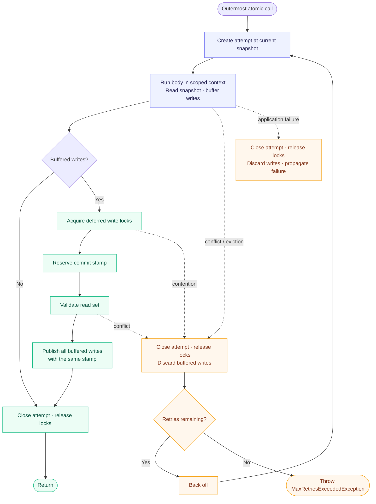

**Transactional memory for Java**

Weft is a transactional memory library for **Java 25**. Transactions buffer changes to
shared `TVar<T>` values and commit them together after validation. Conflicting attempts
are retried automatically.

The core library defaults to optimistic locking. An optional Java agent analyzes read/write
call sites so the runtime can choose between optimistic and pessimistic write locking.

- **Atomic updates** across multiple transactional values, with read-your-writes semantics.
- **Flat nesting** that shares the outer transaction's buffered changes and retry budget.
- **Snapshot reads** that use retained versions when optimistic readers outlive a commit.
- **Read-only commits** that skip validation after successfully reading a consistent snapshot.
- **Thread-confined execution** on platform and virtual threads, with ownership checks.
- **Bounded version history** with public, lock-protected resizing on each TVar.

## Contents

- [Quick start](#quick-start)
- [Build and test](#build-and-test)
- [Architecture](#architecture)
- [Transaction behavior](#transaction-behavior)
- [Concurrency protocols](#concurrency-protocols)
- [Version history](#version-history)
- [Instrumentation agent](#instrumentation-agent)
- [Errors and retries](#errors-and-retries)
- [Design patterns](#design-patterns)
- [Benchmarks](#benchmarks)

## Quick start

Wrap related reads and writes in `Weft.atomic`. For example, transfer a balance between
two accounts in one transaction:

```java
import tech.provokedynamic.weft.atomic.Weft;
import tech.provokedynamic.weft.atomic.TVar;

TVar<Integer> source = new TVar<>(100);
TVar<Integer> destination = new TVar<>(0);

Weft.atomic(() -> {
    int balance = Weft.read(source);
    if (balance >= 10) {
        Weft.write(source, balance - 10);
        Weft.write(destination, Weft.read(destination) + 10);
    }
});
```

Reads within the transaction see its buffered writes, including `null` values. Other
transactions can observe the new values after a successful commit.

Payload nullability follows the type argument. The core uses JSpecify annotations;
declare a nullable type argument when a variable may hold `null`, even if its initial
value is non-null:

```java
import org.jspecify.annotations.Nullable;

var label = new TVar<@Nullable String>("initial");
Weft.atomic(() -> Weft.write(label, null));
```

Reads of this variable have type `@Nullable String`. A `TVar<String>` expresses a
non-null string payload to nullness analysis tools.

Bodies may execute more than once. Keep I/O and irreversible side effects outside them,
and publish computed results after `atomic` returns. Store immutable values or replace
objects through `Weft.write`; mutating a returned object directly bypasses buffering.

## Build and test

Use **JDK 25** and the included wrapper, pinned to **Maven 3.10.0**. Set `JAVA_HOME`
to a JDK 25 installation; no preview flags are required. The wrapper downloads Maven
on its first run (Windows: `mvnw.cmd`).

```bash
./mvnw clean verify
```

This runs the core, agent, and benchmark workload tests, packages all three modules,
and checks programmatic attachment through the shaded agent JAR in a separate JVM:

| Module           | Artifact                                        | Purpose                           |
| ---------------- | ----------------------------------------------- | --------------------------------- |
| `weft-core`      | `weft-core/target/weft-core-1.0-SNAPSHOT.jar`   | Transaction API and runtime       |
| `weft-agent`     | `weft-agent/target/weft-agent-1.0-SNAPSHOT.jar` | Optional bytecode instrumentation |
| `weft-benchmark` | `weft-benchmark/target/benchmarks.jar`          | Runnable JMH suite                |

Generate the aggregated API and benchmark documentation with strict Javadoc checks:

```bash
./mvnw javadoc:aggregate
```

To generate only the core and agent API documentation, use
`./mvnw -pl weft-core,weft-agent -am javadoc:aggregate`.

The core uses the SLF4J API; applications choose their logging backend and configuration.
Core tests use Logback; agent tests and the benchmark JAR use `slf4j-nop`. Dependency
and plugin versions are centralized in
[`pom.xml`](pom.xml). Generated JMH harness classes are excluded from API documentation.

## Architecture

```mermaid
flowchart LR
    app["Application<br/>Weft.atomic · read · write"]
    agent["weft-agent · optional<br/>Analyze local transaction bodies"]

    subgraph core["weft-core"]
        direction TB
        api["Weft<br/>Scope · nesting · retries"]
        context["TransactionContext<br/>Borrowed reads and writes"]
        transaction["Transaction<br/>Snapshot · read/write sets · owned locks"]
        protocol["ConcurrencyProtocol<br/>OPTIMISTIC / PESSIMISTIC_WRITE"]
        variable["TVar&lt;T&gt;<br/>Committed value · version · lock"]
        history["CircularVersionHistory<br/>Retained snapshot values"]

        api -->|"binds in ScopedValue"| context
        api -->|"creates, commits, closes"| transaction
        context -. "implemented by" .-> transaction
        transaction -->|"delegates reads and lock timing"| protocol
        protocol -->|"reads / locks"| variable
        transaction -->|"publishes buffered writes"| variable
        variable -->|"owns"| history
    end

    app --> api
    agent -. "rewrites calls to supply hints" .-> app

    classDef entry fill:#eef2ff,stroke:#6366f1,color:#1e1b4b
    classDef strategy fill:#ecfdf5,stroke:#10b981,color:#064e3b
    classDef storage fill:#fff7ed,stroke:#f59e0b,color:#7c2d12
    classDef optional fill:#f8fafc,stroke:#94a3b8,color:#334155,stroke-dasharray:5 5
    class app,api,context,transaction entry
    class protocol strategy
    class variable,history storage
    class agent optional
    style core fill:#f8fafc,stroke:#cbd5e1,color:#334155
```



The core runs independently of the agent. When enabled, the agent rewrites application
classes to pass workload hints to the core; it does not bundle the core runtime.
The benchmark module depends on the core and uses explicit hints for its forced protocols.

Applications use `Weft`, `TVar<T>`, and `TransactionHints`. `TransactionContext`,
`Transaction`, and the `ConcurrencyProtocol` enum are package-private implementation types.
The enum has two strategies: `OPTIMISTIC` and `PESSIMISTIC_WRITE`.

Naming follows established STM terminology: [`TVar`](https://downloads.haskell.org/~ghc/6.6/docs/html/libraries/stm/Control-Concurrent-STM-TVar.html)
for transactional variables, and [TL2](https://people.csail.mit.edu/shanir/publications/Transactional_Locking.pdf)
terms such as `readVersion`, `readSet`, and `writeSet` for transaction state.

| Component                                                                                                        | Responsibility                                                                |
| ---------------------------------------------------------------------------------------------------------------- | ----------------------------------------------------------------------------- |
| [`Weft`](weft-core/src/main/java/tech/provokedynamic/weft/atomic/Weft.java)                                      | Public API, transaction scope, nesting, and retries                           |
| [`TVar<T>`](weft-core/src/main/java/tech/provokedynamic/weft/atomic/TVar.java)                                   | Committed value, version, history, and lock                                   |
| [`TransactionHints`](weft-core/src/main/java/tech/provokedynamic/weft/TransactionHints.java)                     | Supplied operation counts used to select a protocol                           |
| [`TransactionContext`](weft-core/src/main/java/tech/provokedynamic/weft/atomic/TransactionContext.java)          | Borrowed reads, writes, and thread ownership checks                           |
| [`Transaction`](weft-core/src/main/java/tech/provokedynamic/weft/atomic/Transaction.java)                        | Read version, read/write sets, commit, and lock cleanup                       |
| [`ConcurrencyProtocol`](weft-core/src/main/java/tech/provokedynamic/weft/atomic/ConcurrencyProtocol.java)        | Snapshot access and write-lock timing                                         |
| [`VersionHistory<T>`](weft-core/src/main/java/tech/provokedynamic/weft/mvcc/VersionHistory.java)                 | Version storage and explicit capacity changes                                 |
| [`CircularVersionHistory<T>`](weft-core/src/main/java/tech/provokedynamic/weft/mvcc/CircularVersionHistory.java) | Bounded circular history with binary-search lookup                            |
| [`Clock`](weft-core/src/main/java/tech/provokedynamic/weft/atomic/Clock.java)                                    | Independent `AtomicLong` counters for commit versions and variable identities |
| [`AdaptiveBackoff`](weft-core/src/main/java/tech/provokedynamic/weft/retry/AdaptiveBackoff.java)                 | Retry delays with exponential parking and jitter                              |

## Transaction behavior

Each outermost `atomic` chooses a protocol and creates a retry state. Each attempt then:

1. Creates a fresh `Transaction` at the current commit-clock snapshot.
2. Binds its borrowed view through `ScopedValue<TransactionContext>` while the body records reads and buffers writes.
3. For updates, acquires write locks, reserves a commit stamp, and validates every read.
4. Publishes buffered writes with that stamp, or retries if a conflict occurred.
5. Releases all owned locks before returning, propagating an exception, or backing off.



Read-only transactions check snapshot visibility as they read; they skip commit validation
and do not advance the commit clock. Later writes to variables already read do not invalidate
a successfully read snapshot.

`Weft` owns and closes each `Transaction` through try-with-resources. Reads, writes, and
nested calls use `TransactionContext`, which exposes no commit or cleanup operations.
Application exceptions and errors discard buffered writes when they escape the outer body.

### Nested transactions

Nested `atomic` calls join the current attempt. They see the outer transaction's pending
writes, inherit its protocol, and commit or retry with it. If an exception escapes the
outer body, the nested writes are discarded too.

There are no savepoints: catching an inner application exception inside the outer body
does not undo changes already buffered by that inner body.

### Thread scope

An attempt belongs to its executing thread. Independent transactions may run on platform
or virtual threads. Access from a different thread throws `IllegalStateException`, including
reads, writes, and nested `atomic` calls from structured subtasks that inherit the scoped
binding. Start independent transactions outside the active scope. Scoped bindings end
automatically when the body exits.

## Concurrency protocols

| Operation        | Optimistic                                                     | Pessimistic write                                                    |
| ---------------- | -------------------------------------------------------------- | -------------------------------------------------------------------- |
| Read             | Validated latest value, or retained history under a brief lock | Validated latest value; retry if newer than the snapshot             |
| Write            | Buffer the replacement value                                   | Acquire the write lock, then buffer                                  |
| Updating commit  | Acquire write locks, reserve a stamp, validate, and publish    | Reserve a stamp, validate, and publish with write locks already held |
| Read-only commit | Return without commit validation or a new stamp                | Return without commit validation or a new stamp                      |

Both protocols check snapshot visibility on every read. Optimistic reads use the volatile
value when its version is visible, checking for concurrent writers before and after reading.
This common path needs neither a history scan nor a read lock.
If the latest version is newer than the snapshot, they briefly take the TVar read lock
to scan retained history. Historical readers can share that lock and do not invalidate
latest-value readers. Pessimistic reads use the volatile value and retry if it is newer than the
snapshot. Transactions that buffer writes validate their read set at commit; any historical
read forces an updating attempt to retry. This also prevents stale updates and write skew.
Pessimistic **write** locking does not acquire read locks.

All lock acquisitions use `tryLock()`. Contention aborts the attempt; cleanup releases its
locks before retrying. Optimistic commits acquire locks in TVar identity order. Pessimistic
writes acquire them in application order. Neither protocol waits for a lock while holding
other locks.

### Selecting a protocol

Without hints, `Weft.atomic(body)` uses the optimistic protocol. Supply hints explicitly
with `Weft.atomic(body, new TransactionHints(readOps, writeOps))`, or let the agent inject them.

For example, a write-only hint selects pessimistic write locking:

```java
import tech.provokedynamic.weft.TransactionHints;

TVar<Integer> counter = new TVar<>(0);
Weft.atomic(() -> Weft.write(counter, 1), new TransactionHints(0, 1));
```

| Hint                              | Selected protocol |
| --------------------------------- | ----------------- |
| No hints or zero total operations | Optimistic        |
| Read ratio ≥ 80%                  | Optimistic        |
| Otherwise, write ratio ≥ 60%      | Pessimistic write |
| Otherwise                         | Optimistic        |

Selection happens once per outermost invocation. Counts must be non-negative; the
two-argument `TransactionHints` constructor derives the total with overflow checking. The
three-argument constructor preserves an explicitly supplied normalization total.

## Version history

Every TVar starts with a 32-entry `CircularVersionHistory`, including its initial value at
version zero. `scan(readVersion)` returns the newest retained value at or before that version.
A point older than the retained window causes `VersionEvictedException`.

Resize a TVar's history explicitly between 32 and 2,048 entries. This example expands
the initial 32-entry capacity to 64 entries, then shrinks it back to 32:

```java
TVar<Integer> counter = new TVar<>(0);
counter.expandHistoryByFactor(2);
counter.shrinkHistoryByFactor(0.5f);
```

Expansion preserves retained history without restoring evicted entries; shrinking keeps
the newest entries. Expansion factors must be finite and ≥ 1; shrink factors must be
finite and in (0, 1]. Capacity does not change automatically.

History scans share the TVar read lock; appends and resizing take its write lock.
Resize operations use `tryLock()`
and throw `IllegalStateException` if another thread holds it; they apply immediately and are
not rolled back with transactional writes. A standalone `CircularVersionHistory` still
requires external synchronization. Optimistic read-only attempts can continue through later
commits while their snapshot remains retained. Eviction or an overlapping writer causes
a retry with a fresh snapshot.

## Instrumentation agent

The agent uses the JDK **Class-File API** to analyze and rewrite transaction call sites.
Byte Buddy provides the instrumentation handle for programmatic attachment.

For a directly supplied lambda with one read and one write, the agent replaces
`Weft.atomic(body)` with the equivalent of:

```java
Weft.atomic(() -> {
    int value = Weft.read(counter);
    Weft.write(counter, value + 1);
}, new TransactionHints(1, 1));
```

It resolves directly nested transaction bodies and method references implemented in the
same class. Debug information and line numbers are preserved. Explicit hints are left
unchanged, including during retransformation.

These are **static call-site counts**, not runtime measurements. Loops and branches within
a body are not weighted by execution frequency. Arbitrary helpers and method references
into other classes are not analyzed transitively. Calls receiving a Runnable variable or
a conditional expression such as `condition ? () -> a() : () -> b()` retain their original
overload. Supply explicit hints for those sites when needed.

### Enable at startup

```bash
java -javaagent:weft-agent/target/weft-agent-1.0-SNAPSHOT.jar=com/example/ \
     -cp 'your-app.jar:weft-core/target/weft-core-1.0-SNAPSHOT.jar:lib/*' com.example.Main
```

Here `lib/` contains the application's runtime dependencies, including `slf4j-api`.
Use your application's normal dependency packaging when launching it.

Arguments are comma-separated binary-name prefixes. Dots and slashes are accepted; use
a trailing separator for a package boundary, such as `com.example.,org.other.`. Empty
scan scopes are rejected. The agent excludes its implementation and shaded dependencies,
even when a broad scan prefix would otherwise include them.

### Other activation modes

| Mode         | Entry point                        |
| ------------ | ---------------------------------- |
| Attach API   | `agentmain` on a running JVM       |
| Programmatic | `WeftAgent.attach("com/example/")` |

Attachment depends on JVM support and permissions. Matching modifiable loaded classes are
retransformed in a batch when supported, with individual retries if that batch fails.
Otherwise instrumentation applies to future loads. Class hierarchy resolution reads resources
through each class's defining loader. Failures are reported through `System.Logger`, and
failed transformations retain original bytecode.

Programmatic attachment opts into dynamic agent loading with
`-XX:+EnableDynamicAgentLoading`. The packaged-agent integration test passes this flag
and verifies that already-loaded application classes are transformed.

## Errors and retries

| Condition                                                      | Outcome                                           |
| -------------------------------------------------------------- | ------------------------------------------------- |
| Internal transaction conflict                                  | Release locks, back off, retry                    |
| `VersionEvictedException`                                      | Retry with a fresh snapshot                       |
| Retry budget exhausted                                         | Throw `MaxRetriesExceededException`               |
| Application exception or error                                 | Release locks, discard buffered writes, propagate |
| `read` or `write` outside a transaction                        | Throw `IllegalStateException`                     |
| Read, write, or nested `atomic` using another thread's attempt | Throw `IllegalStateException`                     |
| History resize while another thread holds the TVar lock        | Throw `IllegalStateException`                     |

A user-thrown `ConcurrentModificationException` propagates; it is not treated as an internal
conflict. Internal conflicts and history eviction invalidate the attempt even if application
code catches the exception. Runtime wrappers that preserve an internal retry signal in
their cause chain are also retried after invalidation. Unrelated application failures
and errors still propagate. Internal conflict signals do not capture stack traces.

The budget allows **512 retries after the initial attempt**. Backoff spins on retries 1–8,
parks for 1–16 µs on retries 9–14, and uses a 2–256 µs exponential ladder from retry 15.
Parked delays add 0–5 µs of jitter. At maximum jitter, the full budget requests less than
130 ms of total parking; scheduling and body execution can increase elapsed time.
The same backoff state is retained across retries.

## Design patterns

| Pattern                                                                                                                         | Role in Weft                                                                        |
| ------------------------------------------------------------------------------------------------------------------------------- | ----------------------------------------------------------------------------------- |
| **Strategy** / [Replace Conditional with Polymorphism](https://refactoring.com/catalog/replaceConditionalWithPolymorphism.html) | `ConcurrencyProtocol.OPTIMISTIC` and `PESSIMISTIC_WRITE` vary reads and lock timing |
| [Unit of Work](https://martinfowler.com/eaaCatalog/unitOfWork.html), adapted to memory                                          | `Transaction` tracks observations and buffered changes, then coordinates commit     |
| [Encapsulate Collection](https://refactoring.com/catalog/encapsulateCollection.html)                                            | Read versions, pending writes, and owned locks stay private to `Transaction`        |
| **Scoped resource management**                                                                                                  | `AutoCloseable` releases locks on every exit path before retrying                   |

Protocols are constants of one internal enum. Mutable attempt state belongs to
`Transaction`; retry state belongs to the outer invocation. Independent attempts retain
object identity, even when they share a snapshot timestamp.

## Benchmarks

The JMH suite compares optimistic and pessimistic transactions with an equivalent
lock-based implementation, plus JDK atomic baselines for single-value operations.
It includes configurable access patterns and transaction sizes, concurrent reader/writer
groups, and dedicated instrumentation workloads. Untimed checks validate balances,
completed increments, and agent activation.

```bash
./mvnw clean verify
java -jar weft-benchmark/target/benchmarks.jar -l
java -jar weft-benchmark/target/benchmarks.jar 'WeftBenchmark.transfer' \
     -p accounts=64 -p size=2 -p access=UNIFORM -t 4 -foe true \
     -rf json -rff weft-benchmark/target/transfer-4t.json
```

Defaults are **5 × 2 s warmup**, **8 × 2 s measurement**, and **3 forks**. A benchmark
operation is one invocation, including transaction retries. Throughput, latency,
allocation, and diagnostic runs should be collected separately.

See the [benchmark guide](weft-benchmark/README.md) for workload semantics, a comparison
matrix, latency and GC profiling commands, and agent-on/off verification. Publish new
results with their raw JSON, source revision, JVM options, and machine details.

### Recorded results

The run below used **Temurin 25.0.5**, **JMH 1.37**, **4 worker threads**,
`accounts=64`, `size=2`, `access=UNIFORM`, and `diagnostics=false`, without the agent
or additional JVM options. Compiler blackholes were auto-detected. Each configuration
used 5 × 2 s warmup iterations and 8 × 2 s measurement iterations across 3 forks
(24 measurements). The reader/writer group had three reader threads and one
transfer-writer thread.

Throughput is in **millions of operations per second**, shown as score ± the
JMH-reported 99.9% confidence-interval half-width. Higher is better. The
[raw JMH JSON](benchmark-results/current.json) and
[console log](benchmark-results/current.log) retain the measurements and run settings.

| Workload                    |     OPTIMISTIC |    PESSIMISTIC |         LOCKED |
| --------------------------- | -------------: | -------------: | -------------: |
| Transfer                    |  8.823 ± 0.339 |  7.476 ± 0.169 | 44.523 ± 0.748 |
| Reader/writer group: total  | 21.220 ± 0.944 | 19.526 ± 1.477 | 60.344 ± 0.991 |
| Reader/writer group: reads  | 18.521 ± 0.921 | 16.761 ± 1.549 | 47.100 ± 1.034 |
| Reader/writer group: writes |  2.699 ± 0.090 |  2.765 ± 0.178 | 13.244 ± 0.793 |

The group total sums read and write invocations; a read and a transfer perform
different work. `LOCKED` uses primitive balances under one `ReentrantLock`, while
STM includes boxing, transaction tracking, version history, and retries. The coarse
lock led this small-transaction workload, delivering about 5× the optimistic transfer
throughput. The optimistic transfer score was about 18% higher than pessimistic;
the reader/writer scores had overlapping error intervals. Reader throughput still
varied between forks: optimistic fork means ranged from 17.760 to 20.005 million
ops/s, and pessimistic means from 14.838 to 19.414 million ops/s.
The auxiliary counters were disabled, so their reported zeros do not indicate
an absence of retries.

Compared with the earlier baseline below, transfer throughput rose about **33%**
for optimistic and **21%** for pessimistic. Grouped read throughput rose about
**64%** and **42%**, respectively, while grouped writer scores remained close to
the earlier values. These are observed differences between runs. Several code
changes occurred between them, and machine details and source revisions were not
captured with the results, so they do not isolate the effect of any individual change.

The command used for this run was:

```bash
mkdir -p benchmark-results
java -jar weft-benchmark/target/benchmarks.jar \
     '(WeftBenchmark.transfer|ReaderWriterBenchmark.readWrite)' \
     -p accounts=64 -p size=2 -p access=UNIFORM \
     -p diagnostics=false -p engine=OPTIMISTIC,PESSIMISTIC,LOCKED \
     -t 4 -f 3 -wi 5 -w 2s -i 8 -r 2s -foe true \
     -rf json -rff benchmark-results/current.json \
     | tee benchmark-results/current.log
```

<details>
<summary>Earlier baseline</summary>

This run used the same workload parameters and measurement settings, before shared
history read locks, stackless conflict exceptions, and the revised backoff. Values
are in millions of operations per second, with the JMH-reported error.

| Workload                    |     OPTIMISTIC |    PESSIMISTIC |         LOCKED |
| --------------------------- | -------------: | -------------: | -------------: |
| Transfer                    |  6.626 ± 0.163 |  6.186 ± 0.148 | 45.028 ± 1.156 |
| Reader/writer group: total  | 13.838 ± 2.241 | 14.649 ± 1.779 | 57.325 ± 4.740 |
| Reader/writer group: reads  | 11.262 ± 1.977 | 11.814 ± 1.800 | 45.148 ± 4.747 |
| Reader/writer group: writes |  2.576 ± 0.317 |  2.834 ± 0.061 | 12.177 ± 0.314 |

</details>
